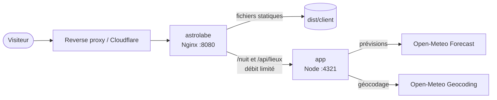

<div align="center">

# Astrolabe

**Planifie tes observations, au bon endroit et au bon moment.**
Un planificateur d'observation astronomique personnel : nuit astronomique, Lune, météo, planètes,
objets Messier, meilleurs créneaux et score de qualité expliqué.

[](https://astro.paulviandier.com)

[](https://astro.build)
[](https://www.typescriptlang.org)
[](https://react.dev)
[](https://tailwindcss.com)
[](https://ui.shadcn.com)
[](https://vitest.dev)
[](https://playwright.dev)
[](https://www.docker.com)
[](LICENSE)

[Fonctionnalités](#fonctionnalités) · [Calculs](#calculs-et-score) · [Architecture](#architecture) · [Démarrage](#démarrage) · [Tests](#tests) · [Déploiement](#déploiement) · [Sécurité](#sécurité) · [Licence](#licence)

</div>

---

## Fonctionnalités

- **Planification d'une nuit** : recherche de lieu avec suggestions, géolocalisation du navigateur
  et calendrier. Sans date choisie, la nuit analysée est celle du jour dans le fuseau du lieu.
- **Soleil et crépuscules** : coucher, lever, fin des crépuscules civil, nautique et astronomique,
  durée de la nuit noire, y compris aux latitudes où elle n'existe pas (soleil de minuit, nuit polaire).
- **Lune** : phase, illumination, lever, coucher, présence pendant la nuit noire et gêne lumineuse.
- **Météo** : couverture nuageuse heure par heure (totale, basse, moyenne et haute), humidité,
  vent, précipitations, température et risque de rosée, jusqu'à 16 jours à l'avance.
- **Planètes** : visibilité, heure et hauteur maximales, lever, coucher, magnitude, constellation
  et instrument conseillé.
- **Objets Messier** : les 110 objets du catalogue, avec ceux réellement observables pendant la nuit,
  des filtres et une fiche par objet (coordonnées, meilleure période, latitudes favorables).
- **Meilleurs créneaux** et **score sur 100**, détaillés facteur par facteur.
- **Graphique de la nuit** explorable à la souris et au clavier, accompagné d'un tableau de données.
- **Favoris** (lieux et objets) conservés uniquement dans le navigateur, avec validation stricte
  des données relues.
- Thèmes clair et sombre, animations fluides limitées à `transform` et `opacity`, respect de
  `prefers-reduced-motion`, navigation au clavier et focus visible.

## Calculs et score

Les positions du Soleil, de la Lune et des planètes, les levers, couchers, crépuscules et phases
lunaires sont calculés avec [Astronomy Engine](https://github.com/cosinekitty/astronomy). Les
coordonnées J2000 des objets Messier sont précessées à la date d'observation avant le calcul de
leur hauteur. La nuit est échantillonnée toutes les 10 minutes.

| Facteur     | Calcul                                                                            |
| ----------- | --------------------------------------------------------------------------------- |
| Obscurité   | Heures de ciel noir pondérées (0 à -12°, 1 sous -18°), maximum atteint à 8 heures |
| Lune        | 1 - illumination × part de la nuit noire pendant laquelle la Lune est levée       |
| Ciel dégagé | 1 - couverture nuageuse moyenne pendant la nuit                                   |
| Atmosphère  | Légère pénalité au-delà de 80 % d'humidité et de 20 km/h de vent                  |

Le score vaut `100 × (50 % obscurité + 50 % Lune) × ciel dégagé × atmosphère`. Hors de la portée
des prévisions, seuls l'obscurité et la Lune sont pris en compte, et l'interface le signale.

## Architecture

Le site est statique par défaut : l'accueil, le catalogue et les 110 fiches d'objets sont
prégénérés. Seuls le rapport de nuit (`/nuit`) et la recherche de lieux (`/api/lieux`) sont
rendus par le serveur Node. Les composants React ne sont hydratés que lorsqu'ils sont interactifs ;
le calendrier et la liste de recherche sont chargés à la demande.



| Couche       | Rôle                                                                                        |
| ------------ | ------------------------------------------------------------------------------------------- |
| `domain`     | Calculs purs et testables : Soleil, Lune, planètes, ciel profond, score, créneaux, météo    |
| `services`   | Accès aux API externes (validation Zod, délai d'expiration, cache mémoire) et orchestration |
| `lib`        | Utilitaires génériques : dates et fuseaux, formatage, validation, cache, HTTP               |
| `data`       | Métadonnées du site et catalogues (Messier, constellations, types d'objets)                 |
| `components` | Composants d'interface Astro et React, dont les primitives shadcn/ui dans `ui`              |

```text
.
├── docker/                 Configuration Nginx et en-têtes de sécurité
├── src/
│   ├── assets/             Illustration
│   ├── components/
│   │   ├── astronomy/      Planificateur, rapport de nuit, catalogue
│   │   ├── layout/         En-tête, pied de page, SEO, thème
│   │   └── ui/             Primitives shadcn/ui et composants génériques
│   ├── data/
│   │   └── catalog/        Objets Messier, constellations, types d'objets
│   ├── domain/
│   │   ├── astronomy/      Soleil, Lune, planètes, ciel profond
│   │   ├── observation/    Nuit, score, créneaux, rapport
│   │   └── weather/        Prévisions et synthèse météo
│   ├── hooks/              Hooks React (favoris, recherche de lieux)
│   ├── layouts/            Mise en page de base
│   ├── lib/
│   │   ├── cache/          Cache mémoire à durée de vie
│   │   ├── date/           Fuseaux horaires et formatage des dates
│   │   └── validation/     Schémas Zod (lieux, requêtes, favoris)
│   ├── pages/              Routes, API, icônes, manifeste et image Open Graph générés
│   ├── scripts/            Scripts client sans framework (thème, graphique)
│   ├── services/           Astronomie, géocodage et météo
│   └── styles/             Jetons de thème et styles globaux
└── tests/
    ├── e2e/                Parcours Playwright (bureau et mobile)
    └── unit/               Tests Vitest du domaine, des services et des utilitaires
```

## Stack technique

| Domaine    | Outils                                                                                                              |
| ---------- | ------------------------------------------------------------------------------------------------------------------- |
| Framework  | [Astro](https://astro.build) 7 (adaptateur Node autonome) et îlots [React](https://react.dev)                       |
| Interface  | [Tailwind CSS](https://tailwindcss.com) 4, [shadcn/ui](https://ui.shadcn.com) (Radix), [Lucide](https://lucide.dev) |
| Astronomie | [Astronomy Engine](https://github.com/cosinekitty/astronomy)                                                        |
| Données    | [Open-Meteo](https://open-meteo.com) (prévisions et géocodage, sans clé API)                                        |
| Validation | [Zod](https://zod.dev) (mini)                                                                                       |
| Tests      | [Vitest](https://vitest.dev), [Playwright](https://playwright.dev)                                                  |
| Exécution  | Docker, Docker Compose, Nginx non root                                                                              |

## Démarrage

### Prérequis

- [Node.js](https://nodejs.org) 22.23.4 ou plus récent
- [pnpm](https://pnpm.io) 12 (la version exacte est fixée dans `packageManager`, `corepack enable`
  suffit)

Aucune variable d'environnement ni clé d'API n'est nécessaire.

```bash
pnpm install
pnpm dev
```

Le site est ensuite accessible sur <http://localhost:4321>.

### Scripts

| Commande        | Description                                                  |
| --------------- | ------------------------------------------------------------ |
| `pnpm dev`      | Lance le serveur de développement                            |
| `pnpm check`    | Vérifie le typage et les diagnostics Astro                   |
| `pnpm test`     | Exécute les tests unitaires                                  |
| `pnpm build`    | Vérifie le typage puis génère le site dans `dist/`           |
| `pnpm preview`  | Lance le serveur de production construit                     |
| `pnpm test:e2e` | Exécute les tests de bout en bout sur le build de production |

## Tests

```bash
pnpm test
pnpm build
pnpm exec playwright install chromium
pnpm test:e2e
```

Les tests unitaires couvrent les calculs astronomiques (vérifiés sur des cas réels et polaires),
la cohérence du catalogue avec les frontières des constellations, le score, les créneaux, la
synthèse météo, le cache, la validation des entrées et le formatage. Les tests de bout en bout
parcourent l'application sur bureau et sur mobile sans dépendre des services externes : la recherche
de lieux est simulée et les dates testées sont hors de la portée des prévisions. Ils vérifient
aussi l'absence d'erreur dans la console, donc de violation de la Content Security Policy, et
l'absence de défilement horizontal.

## Déploiement

La stack est décrite dans [`compose.yaml`](compose.yaml) et construite depuis un seul
[`Dockerfile`](Dockerfile) multi-étapes :

| Service     | Image                         | Rôle                                                                 |
| ----------- | ----------------------------- | -------------------------------------------------------------------- |
| `astrolabe` | `nginx-unprivileged` (Alpine) | Sert le site statique précompressé et relaie `/nuit` et `/api/lieux` |
| `app`       | `node` (Alpine)               | Calcule les rapports de nuit et interroge Open-Meteo                 |

```bash
docker compose up -d --build
```

Les services exposent leurs ports sur le réseau Compose sans les publier sur l'hôte. Place un
reverse proxy ou un tunnel (par exemple Cloudflare Tunnel) sur le même réseau et redirige le trafic
vers `astrolabe:8080`. Le service `app` doit pouvoir joindre `api.open-meteo.com` et
`geocoding-api.open-meteo.com`.

## Sécurité

<details>
<summary><strong>Application</strong></summary>

- Content Security Policy à base d'empreintes générée par Astro, sans `unsafe-inline` :
  `default-src`, `connect-src` et `img-src` limités à `self`.
- Chaque paramètre de requête, réponse d'API externe et donnée relue depuis `localStorage` est
  validé avec Zod (coordonnées bornées, fuseaux IANA réels, dates existantes, caractères de
  contrôle refusés, tailles maximales).
- Les appels sortants visent uniquement des hôtes fixes, avec un délai d'expiration, et leurs
  réponses sont mises en cache en mémoire avec une taille bornée.
- Les erreurs ne révèlent aucun détail interne et aucun texte externe n'est injecté comme HTML.

</details>

<details>
<summary><strong>Nginx</strong></summary>

- Seules les méthodes `GET` et `HEAD` sont acceptées.
- `/nuit` et `/api/lieux` sont limités en débit par adresse IP, les autres routes `/api/` renvoient
  `404`.
- En-têtes de sécurité sur chaque réponse : HSTS, `frame-ancestors 'none'`,
  `X-Content-Type-Options`, `X-Frame-Options`, `Referrer-Policy`, `Permissions-Policy`
  (géolocalisation limitée au site) et `Cross-Origin-Opener-Policy`.
- Cache long et immuable pour les ressources versionnées et fichiers gzip précompressés.

</details>

<details>
<summary><strong>Conteneurs</strong></summary>

- Images de base fixées par version et par empreinte SHA-256, contexte de build en liste blanche.
- Paquets système mis à jour au build, gestionnaires de paquets Node (npm, Yarn, Corepack) retirés
  de l'image d'exécution.
- Utilisateurs non root, fichiers applicatifs appartenant à `root`, systèmes de fichiers en lecture
  seule, capacités Linux retirées, `no-new-privileges`, limites de ressources et health checks.

</details>

Tu as trouvé une vulnérabilité ? Signale-la en privé
à [contact@paulviandier.com](https://paulviandier.com/contact) plutôt que d'ouvrir une issue
publique.

## Sources et attributions

- Données météo et géocodage : [Open-Meteo](https://open-meteo.com), sous licence
  [CC BY 4.0](https://creativecommons.org/licenses/by/4.0/).
- Calculs astronomiques : [Astronomy Engine](https://github.com/cosinekitty/astronomy), licence MIT.
- Coordonnées et magnitudes du catalogue Messier issues des données publiques de référence (J2000).

## Licence

© 2026 Paul Viandier. Tous droits réservés.

Ce dépôt est public uniquement pour être consulté. Toute copie, modification, redistribution ou
réutilisation, même partielle, du code, des textes ou des visuels est interdite sans autorisation
écrite préalable. Consulte le fichier [`LICENSE`](LICENSE) pour le détail. Les dépendances et
données tierces restent soumises à leurs licences respectives.
